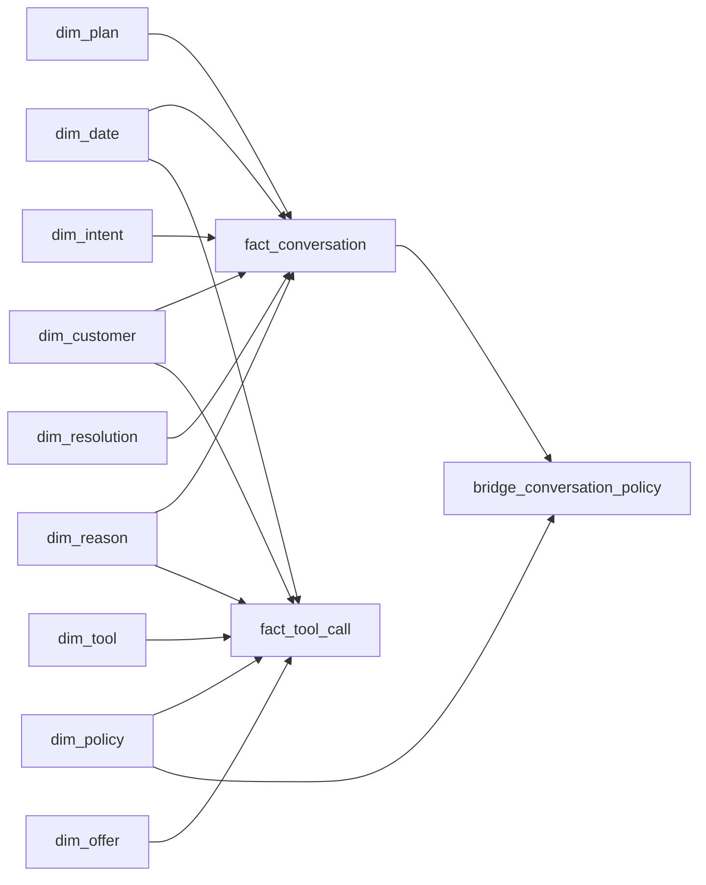

# Analytics star schema

The PostgreSQL `analytics` database contains two stars sharing denormalized dimensions.
`analytics_app` owns these tables; support data is read through the separate `support_reader` connection.
The schema stores analytics and copied audit events without modifying the operational database.

## Grain and tables

| Table | Grain or purpose |
|-------|------------------|
| `fact_conversation` | One completed, analyzed conversation per unique `session_id` |
| `fact_tool_call` | One original support audit record per unique `audit_id`, including unsuccessful calls |
| `dim_date` | One UTC calendar day, with generated YYYYMMDD key and calendar attributes |
| `dim_customer` | One source `user_id`; country and signup timestamp, without names or emails |
| `dim_plan` | One plan code, with current price and seat count |
| `dim_intent` | One primary-intent code from the transcript contract |
| `dim_reason` | One underlying-reason code from the transcript contract |
| `dim_resolution` | One conversation-outcome code from the transcript contract |
| `dim_tool` | One tool name, including whether it changes state |
| `dim_policy` | One current policy section, identified by `doc_id#section` |
| `dim_offer` | One retention-offer code |
| `bridge_conversation_policy` | One unique conversation/policy pair for cited policies |
| `analysis` | Read-only logical output view matching the original analysis field names |



The fact tables share `session_id` as a source identifier and have no fact-to-fact foreign key.
Audit rows can therefore arrive before conversation analysis, and missing analysis does not discard audit evidence.
The policy bridge handles multiple citations without changing the conversation grain.

## Measures

Conversation measures include generated duration in seconds, start/end sentiment, churn risk,
three quality scores, estimated resolution quality, and a knowledge-base-gap flag.
Sentiment is between -2 and 2, churn risk between 0 and 1, and quality scores between 1 and 5.
Use NULL for estimates that cannot be supported; NULL is different from neutral sentiment or a zero score.
`kb_gap` is an explicit analyzer judgment and must be supplied.

Tool-call rows contain status, autonomy, actor, original arguments, and optional verified refund amount/currency.
JSONB arguments provide drill-down context; quality measures and monetary values have typed columns.
Refund amounts must be positive, associated with a payment and currency, and attached only to a successful call.
A partial unique index permits at most one attributed refund amount per source payment.

## Loading contract for the analyzer

1. Read a completed transcript and its support audit records using separate source connections.
2. Insert each required UTC date into `dim_date(full_date)` with `ON CONFLICT DO NOTHING`.
   The database generates its date key and calendar attributes; timestamps must match their UTC date key.
3. Upsert customers by `user_id` and resolve the other dimension keys by their natural codes.
   Reference dimensions are initialized from the current contracts and policy documents.
4. Capture `plan_key` from the profile as it was at conversation start, before any plan-changing action.
   Use plan key 0 when historical evidence is unavailable instead of guessing from the final account state.
   Customer key 0 represents missing customer context in an audit event.
5. Upsert `fact_conversation` on `session_id`, replacing the latest analysis measures while preserving its identity.
   Upsert copied audit records in `fact_tool_call` on `audit_id`; never create a new audit identity during retries.
6. Attribute refund amounts only to the canonical successful `issue_refund` audit event, verified against the
   matching refunded payment and its amount/currency. Do not infer success from assistant text or copy the
   amount to retries, denied calls, or separate confirmation audit events.
7. Populate `offer_key` from the retention-offer code in the call arguments when relevant.
   Store only actual citations in the policy bridge, using conflict-safe inserts; on reanalysis replace that
   session's bridge associations transactionally so removed citations do not remain stale.
8. Commit a session's analysis, audit imports, and policy associations together. If parsing or validation fails,
   roll back the session and report the failure; do not partially publish its analysis.

The initial dimensions use Type 1 maintenance: descriptive corrections overwrite their existing attributes.
Plan-at-start is preserved by the conversation fact, but country and dimension prices are not historical snapshots.
Do not calculate past financial activity from `dim_plan.monthly_price`; use recorded payment amounts.
Historical country or pricing versions would require a later Type 2 dimension migration.
Audit IDs are scoped to the current support database; importing independent or reset support databases requires
an added source-instance identifier before combining their audit histories.

## Dashboard aggregation

- Count conversations and calculate outcome rates from `fact_conversation` alone.
  Resolved without escalation includes `resolved_auto`, `retained`, `canceled`, and `refunded`;
  use all analyzed conversations as the denominator and show abandoned sessions separately.
- Group cancellation reasons by the conversation intent and reason dimensions, not every tool's reason.
- Count accepted retention offers from successful `apply_retention_offer` calls, grouped by `dim_offer`.
  Count retained conversations separately: a pause or plan change is not a retention offer.
- Sum verified `refunded_amount` by currency. Automatic refunds additionally require `autonomy_level = 'auto'`
  and `actor = 'agent'`; unverified amounts remain NULL and should be reported as incomplete rather than zero.
- Average quality scores using non-NULL observations and display their assessed sample size.
- For audit drill-down, show every tool-call row for the selected `session_id`, including failures and proposals.

Aggregate the two fact tables separately before combining results at session or day level.
Joining raw conversation facts to many tool calls or citations multiplies conversation measures.
The `analysis` view avoids that multiplication by aggregating actions and citations independently per session;
its JSON fields are a compatibility projection, not the physical storage model.

## Apply, verify, and roll back

New Docker volumes initialize this schema automatically. On an existing database, run from the project root:

```powershell
Get-Content -Raw analytics/schema.sql | docker compose exec -T db psql -U analytics_app -d analytics -v ON_ERROR_STOP=1
Get-Content -Raw analytics/tests/check-star-schema.sql | docker compose exec -T db psql -U analytics_app -d analytics -v ON_ERROR_STOP=1
python -m unittest discover -s analytics/tests -v
```

The SQL baseline runs in a transaction and can be reapplied without clearing existing data.
It uses `CREATE TABLE IF NOT EXISTS` for the initial structure, not as a substitute for later schema migrations.
A pre-existing legacy `analysis` table prevents view creation and rolls back this baseline instead of overwriting data.
Verification fixtures are transactionally rolled back; identity sequences may advance during checks.
To roll back application code, stop using these new tables and revert the code changes while retaining the database.
No destructive down migration is supplied; export any collected facts before considering removal.
